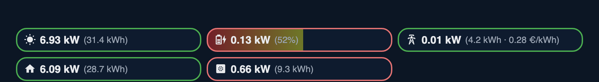
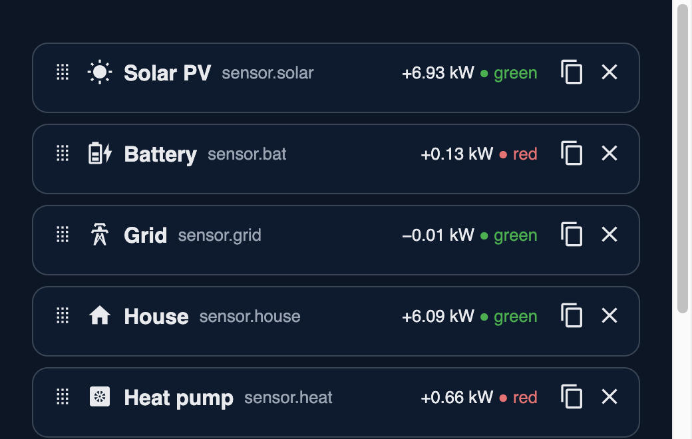
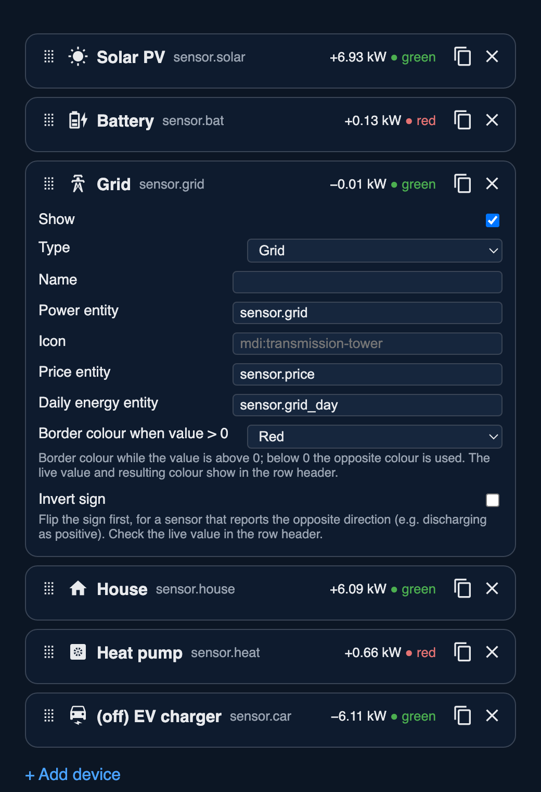

# Slim Energy Card

A compact Home Assistant Lovelace card that shows your energy flows in a few small pills: solar, battery, grid, home, heat pump, EV charger, or anything else with a power sensor. Three pills per row, so it fits in a narrow dashboard slot where a full energy-flow card is too big.



## Features
- One pill per device: icon, live power in kW, and optional values in brackets.
- Border colour shows the energy direction (green or red, configurable per device, can be inverted).
- Brackets show what matters per device type: battery state of charge, daily energy (kWh), grid price.
- Visual editor: drag to reorder, copy, remove, and switch any device off. Only fields that apply to the device type are shown.
- Standard `mdi:` icon per device type (sun, battery, tower, house, heat pump, car); override with any `mdi:` icon or emoji.
- Tap a pill to open the entity's more-info dialog.
- W values are converted to kW automatically. No dependencies, one JS file.

## Install
1. HACS → ⋮ → Custom repositories → `https://github.com/koehntopp/ha-slimenergy`, type *Dashboard* → Download.
2. If it isn't added automatically: Settings → Dashboards → Resources → `/hacsfiles/ha-slimenergy/slim-energy-card.js`, type *JavaScript module*.
3. Reload the browser, then add the card *Slim Energy Card*.

## Configuration
Use the visual editor, or YAML.



Each device has a type. The type sets the default icon and border colour, and decides which fields are offered (battery: state of charge entity, grid: price entity).



```yaml
type: custom:slim-energy-card
entities:
  - type: solar                        # solar|battery|grid|home|heatpump|ev|other
    entity: sensor.solar_power
    daily_entity: sensor.solar_energy_today   # kWh, shown in brackets
  - type: battery
    entity: sensor.battery_power
    soc_entity: sensor.battery_soc     # shows (52%)
    soc_fill: true                     # optional: pill filled red->green by SoC
  - type: grid
    entity: sensor.grid_power
    price_entity: sensor.grid_price    # grid only; bracket: (4.2 kWh · 0.28 €/kWh)
    daily_entity: sensor.grid_import_today
  - type: home
    entity: sensor.house_power
    name: House                        # tooltip and editor label
    enabled: false                     # hide this device
```

### Device options
| Option | Default | Description |
|---|---|---|
| `type` | `other` | `solar`, `battery`, `grid`, `home`, `heatpump`, `ev`, `other` |
| `entity` | required | Power sensor (W or kW). Shown as absolute kW. |
| `name` | type name | Tooltip and editor label |
| `icon` | per type | Any `mdi:...` icon or an emoji. Defaults: solar `mdi:white-balance-sunny`, battery `mdi:battery-charging-medium`, grid `mdi:transmission-tower`, home `mdi:home`, heat pump `mdi:heat-pump`, EV `mdi:car-electric`, other `mdi:flash` |
| `soc_entity` | | Battery only: state of charge, shown as `(52%)` |
| `soc_fill` | `false` | Battery only: fill the pill from the left up to the state of charge, with a red to green gradient |
| `price_entity` | | Grid only: price, shown in brackets |
| `daily_entity` | | Daily energy sensor in kWh or Wh, shown in brackets |
| `positive_color` | per type | Border colour when the value is above 0: `green` or `red`. Solar, home, other: green. Battery, grid, heat pump, EV: red. The opposite colour is used below 0. |
| `invert` | `false` | Flip the sign before colouring |
| `enabled` | `true` | `false` hides the device |
| `decimals` | `2` | Decimals of the power value |
| `threshold` | `0.005` | Below this many kW the border stays neutral |

Border colours can be themed with the CSS variables `--slim-green` and `--slim-red`.

## Licence
MIT, see [LICENSE](LICENSE). Icons come from Home Assistant's built-in Material Design Icons.
